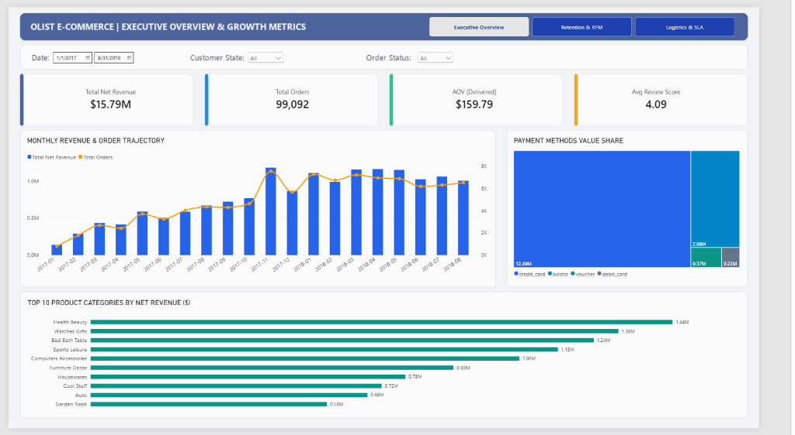
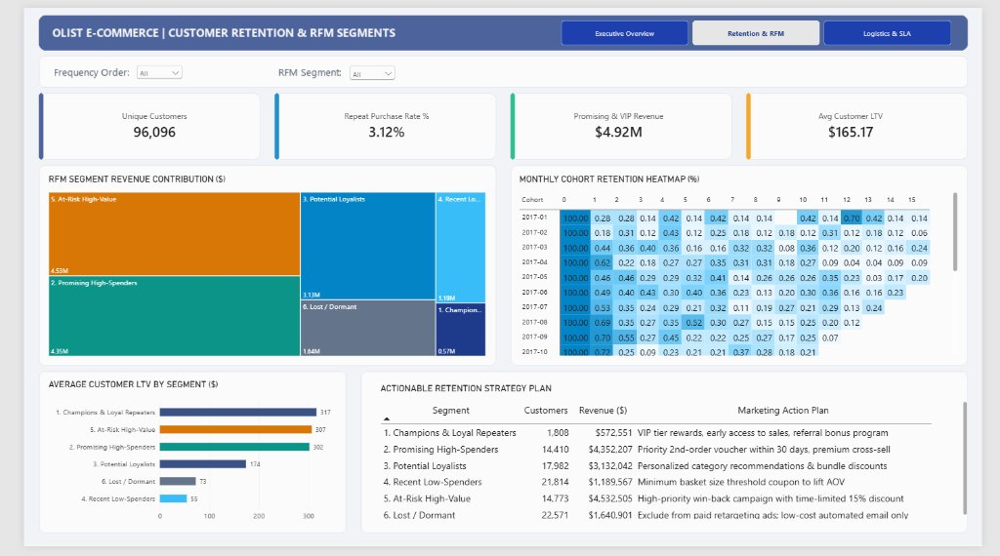
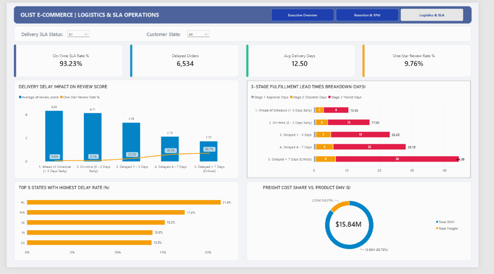

# 🛒 Olist E-Commerce Analytics & Business Intelligence

[](https://python.org)
[](https://www.microsoft.com/sql-server)
[](https://powerbi.microsoft.com)

> **Project Artifacts**: [🌐 Live Power BI Dashboard](https://app.powerbi.com/view?r=eyJrIjoiMmJiNTMyMTUtYWI4NS00MzI2LWEzZDItOGFiNjBjYzA3YTQwIiwidCI6IjVlOGIzMjY5LTc2Y2EtNDU3Yy04NDdmLTQ0NGUzZGI5ODZhNyIsImMiOjl9) | [📊 Power BI File (`.pbix`)](powerbi/Olist_Ecommerce_Analytics.pbix) | [📓 Python EDA Notebook](notebooks/01_exploratory_data_analysis.ipynb) | [🗄️ SQL Analytical Scripts](sql/)

[](https://app.powerbi.com/view?r=eyJrIjoiMmJiNTMyMTUtYWI4NS00MzI2LWEzZDItOGFiNjBjYzA3YTQwIiwidCI6IjVlOGIzMjY5LTc2Y2EtNDU3Yy04NDdmLTQ0NGUzZGI5ODZhNyIsImMiOjl9)
*Click the image to open the interactive dashboard.*

---

## 1. Business Context & Core Challenges
An end-to-end analytics and business intelligence investigation of **99,441 orders** (**$15.84M Net Revenue** / **$13.59M GMV**) from **2016 to 2018** across **Olist**, Brazil's largest e-commerce marketplace, addressing three critical business bottlenecks:
* **Growth Plateau**: Monthly order volume plateaued at **~6,500–7,200 orders/month** throughout H1 2018 following the November 2017 Black Friday peak (7,544 orders).
* **Severe Customer Churn**: **96.88%** of customers purchased only once (*Repeat Purchase Rate = 3.12%*, *M1 Cohort Retention < 0.75%*).
* **Logistics SLA Bottlenecks**: **6.77%** delayed orders (6,534 orders) caused average customer review scores to plunge from **4.29★ to 2.27★**, with **53.7%** of late deliveries resulting in a 1-star rating.

---

## 2. Pipeline & Data Model (Star Schema)

| 📂 1. Data Source | ➡️ | 🐍 2. Python EDA & ETL | ➡️ | 🗄️ 3. SQL Server DWH | ➡️ | 📊 4. Power BI Analytics |
| :---: | :---: | :---: | :---: | :---: | :---: | :---: |
| **8 Raw CSVs**<br>*(99.4K Orders, 112.6K Items)* | | **`pyodbc` Bulk Pipeline**<br>*(Clean, Deduplicate, Translate)* | | **Star Schema**<br>*(7 Tables + 4 SQL Views)* | | **Interactive Dashboard**<br>*(24 DAX Measures, 3 Pages)* |

* **Fact Tables**: `orders`, `order_items`, `order_payments`, `order_reviews`
* **Dimension Tables**: `customers`, `sellers`, `products`, `Dim_Date`
* **Analytical Views**: `vw_monthly_executive_kpis`, `vw_cohort_retention_metrics`, `vw_customer_rfm_segments`, `vw_logistics_sla_performance`

---

## 3. Key Findings & Dashboard Showcase

| Dashboard Page | Key Business Insights | Report Preview |
| :--- | :--- | :--- |
| **Page 1: Executive Overview** | • Top 5/73 product categories (*Health Beauty, Watches Gifts, Bed Bath Table, Sports Leisure, Computers*) generate **39.2% of total net revenue**.<br>• Credit Cards (`credit_card`) account for **78.34%** of payment volume ($12.54M), followed by `boleto` (**17.92%**). |  |
| **Page 2: Retention & RFM** | • `Champions & Loyal Repeaters` achieve an average LTV of **$316.27** (nearly 2x the marketplace average of **$165.17**).<br>• `Promising High-Spenders` ($4.35M) & `At-Risk High-Value` ($4.53M) together drive **57.63% of net revenue ($8.88M)**. |  |
| **Page 3: Logistics & SLA** | • **85% of severe delay variance** occurs in *Stage 3 Carrier In-Transit* (surging 5x from **7.7 days to 37.8 days** for orders delayed >7 days, driving 1★ complaints from **6.6% to 69.7%**).<br>• Northeast states suffer the highest delay rates: **Alagoas (21.4%)**, **Maranhão (17.4%)**, and **Sergipe (15.2%)**. |  |

---

## 4. Strategic Actions & Recommendations

| Target Segment / Issue | Recommended Action Plan | Expected Business Impact |
| :--- | :--- | :--- |
| **Promising High-Spenders** *(14,410 customers)* | Trigger automated 2nd-order voucher within 30 days of initial purchase paired with premium category cross-sell. | Lift overall Repeat Purchase Rate from **3.12% to > 5.0%**. |
| **At-Risk High-Value** *(14,773 customers)* | Launch targeted win-back campaign with a time-limited 15% discount tailored to past purchase categories. | Recover 10–15% of revenue from a **$4.53M** high-value customer pool. |
| **Lost / Dormant** *(22,571 customers)* | Exclude from paid retargeting ad spend; shift to zero-cost automated email sequences only. | Eliminate wasted marketing spend and optimize Customer Acquisition Cost (CAC). |
| **Logistics Bottlenecks** *(AL, MA, SE, PI, CE)* | Reallocate long-haul 3PL carriers on Northeast routes and trigger proactive delay alerts at > 15 days in transit. | Reduce nationwide SLA delay rate to **< 4.0%** and lift overall CSAT above **4.25★**. |

---

## 5. Technical Highlights

<details>
<summary><b>▶ SQL: RFM Customer Segmentation (NTILE Quintiles & Custom Frequency Tiers)</b></summary>

```sql
WITH Base_Customer_Data AS (
    SELECT 
        c.customer_unique_id,
        DATEDIFF(day, MAX(o.order_purchase_timestamp), '2018-09-03') AS recency_days,
        COUNT(DISTINCT o.order_id) AS frequency_orders,
        SUM(oi.price + oi.freight_value) AS monetary_value
    FROM dbo.customers c
    INNER JOIN dbo.orders o ON c.customer_id = o.customer_id
    INNER JOIN dbo.order_items oi ON o.order_id = oi.order_id
    WHERE o.order_status = 'delivered'
    GROUP BY c.customer_unique_id
)
SELECT 
    customer_unique_id,
    NTILE(5) OVER (ORDER BY recency_days DESC) AS r_score,
    CASE 
        WHEN frequency_orders >= 3 THEN 5
        WHEN frequency_orders = 2 THEN 4
        ELSE 1 
    END AS f_score,
    NTILE(5) OVER (ORDER BY monetary_value ASC) AS m_score
FROM Base_Customer_Data;
```
</details>

<details>
<summary><b>▶ DAX: Core Executive, Retention & SLA Measures</b></summary>

```dax
AOV (Delivered) = 
VAR DeliveredRev = CALCULATE([Total Net Revenue], orders[order_status] = "delivered")
RETURN DIVIDE(DeliveredRev, [Delivered Orders], 0)

Promising & VIP Revenue = 
CALCULATE(
    SUM(vw_customer_rfm_segments[monetary_value]),
    vw_customer_rfm_segments[customer_segment] IN {
        "1. Champions & Loyal Repeaters",
        "2. Promising High-Spenders"
    }
)

State Delay Rate % = 
IF(
    DISTINCTCOUNT(vw_logistics_sla_performance[order_id]) >= 300,
    DIVIDE(
        SUM(vw_logistics_sla_performance[is_delayed_flag]),
        COUNT(vw_logistics_sla_performance[order_id]),
        0
    ),
    BLANK()
)
```
</details>

---

## 6. Repository Structure & How to Run Locally

```text
project_cv/
├── data/raw/                                  # 8 raw Olist E-Commerce CSV datasets
├── notebooks/01_exploratory_data_analysis.ipynb
├── src/clean_and_load.py                      # Python pyodbc ETL pipeline into SQL Server
├── sql/                                       # 01_create_tables.sql -> 06_logistics_sla_impact.sql
├── powerbi/Olist_Ecommerce_Analytics.pbix     # 3-Page Power BI Dashboard
├── docs/images/                               # Dashboard screenshots
└── requirements.txt
```

```bash
# 1. Install Python dependencies
pip install -r requirements.txt

# 2. Initialize SQL Server schema & run Python ETL pipeline
sqlcmd -S .\SQLEXPRESS -i sql/01_create_tables.sql
python src/clean_and_load.py

# 3. Apply constraints, indexes & create analytical views (02 -> 06)
sqlcmd -S .\SQLEXPRESS -i sql/02_create_constraints_and_indexes.sql
sqlcmd -S .\SQLEXPRESS -i sql/03_monthly_executive_kpis.sql
sqlcmd -S .\SQLEXPRESS -i sql/04_cohort_retention_analysis.sql
sqlcmd -S .\SQLEXPRESS -i sql/05_rfm_customer_segmentation.sql
sqlcmd -S .\SQLEXPRESS -i sql/06_logistics_sla_impact.sql
```

---
**Author**: Dao Viet Anh • [GitHub Portfolio](https://github.com/vietanh2005a)
